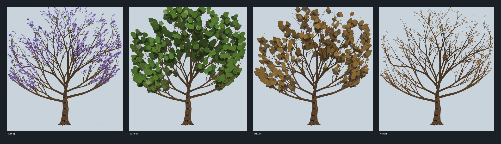

# The Paulownia — one tree, rendered once, projected everywhere

**Scope:** the Home sky scene's ground, photographic themes (`REAL_SKY`, `ATMOSPHERIC_SKY`). The
valley's flowering cherry and its umbrella-crowned Paulownia are gone; every Paulownia in the
landscape is now the supplied **`Paulownia.kt` design**, and all of them are copies of a single
render.



*The design's tree, baked once per season and drawn from the same geometry and the same palette in
every panel: spring panicles of lilac bells on bare wood, summer cordate leaves, autumn capsules and
felted buds, winter wood. Generated by `tools/paulownia/preview_paulownia.py`, which mirrors
`PaulowniaTree.kt` + `PaulowniaSprite.kt` function for function.*

---

## 1. What the design is

The attached file models a mature *Paulownia tomentosa* at true botanical scale and ships it as a
3D mesh scene: 13.8 m tall, a 0.62 m trunk at breast height with root flare and a swollen fork at
2.8 m, **eight hand-placed scaffold limbs** staggered up the leader between 2.35 and 4.25 m,
recursive fork growth under a per-axis energy budget, current-year shoots and crown gap-fill twigs,
all growing toward one flattened crown ellipsoid — centre `(0, 8.35, 0)` m, radii
`(5.90, 4.55, 3.35)` m, a 13.4 m crown on a 13.8 m tree. Season by season it dresses that skeleton:

| Season | Wardrobe |
|---|---|
| spring | terminal panicles of 4–7 cm pale-lilac bells **before the leaves**, cream/yellow throats, deep-purple throat sectors, a few expanding leaves, fallen corollas below |
| summer | opposite cordate leaves up to ~42 cm, midrib colour, pale tomentose undersides, developing green capsules, the first rusty bud panicles |
| autumn | sparse brown/olive retained leaves (the species has no golden fall colour), ripe tan capsules splitting on the tree, dense felted buds for next spring |
| winter | bare coarse twig network, dark split capsules, rusty terminal bud panicles, pale circular leaf scars |

In the app the wardrobe follows the **month of the instant the sky is drawn for** — the same Julian
date the ephemeris is computed for — so a Home sky in April shows blossom on the trees below it and
one in January shows the bare architecture. See `PaulowniaSeason.forJulianDay`.

## 2. Why it is not a GL view

The design's own integration notes offer two paths: a `GLSurfaceView` overlay, or drawing into an
existing GL renderer. Both are the right shape for a hero close-up of one tree and the wrong shape
here:

- the landscape's Paulownias are **25–90 px tall** on the canvas — a 376k-vertex spring mesh to
  produce a 60 px crown is roughly 400k triangles and tens of megabytes of vertex buffers per
  frame;
- `HeroSkyCanvas` is a Compose canvas, its ground pass is a set of cached `Path` replays, and the
  scene already owns its compositing (the Persepolis relief is a `TextureView` standing *in* it);
  a second EGL context for scenery would be a heavier, less composable path than the one the rest
  of the ground uses;
- the ground repaints about once a second at idle and per frame while the finger scrubs time. A
  per-frame 3D re-render to serve a 60 px blit is pure waste.

So the design is kept, and *rendered once*.

## 3. How it works

```
PaulowniaTree.kt            PaulowniaSprite.kt               SceneGroundRenderer.kt
grow the design's tree  →   rasterise it, once per      →    blit it at every planting
(600 axes, one per        season and display size,           (mirror, aerial fade, one
process) + place the      ~300–580 px bitmap: bark,          colour multiply per frame)
season's organs           leaves, bells, capsules
```

**`PaulowniaTree`** — pure Kotlin, no Compose or Android, so a JVM test can assert it.
It reproduces the design's growth: the same 32-bit LCG with the same constants and consumption
order, the same eight scaffolds, the same step/taper/energy rules, the same crown-shell clamp
(`cd > 0.93` bends an axis back along the ellipsoid gradient) and the same 1.2 m growth floor.
It is bounded to **600 axes** (the design uses 1,050 for its close-up) and adds the design's
**130 crown-fill twigs**, because without them the recursive scaffold is a candelabra with no
tips — and every tip is where a leaf, a panicle or a capsule lives. The organs are then placed
where the design places them: terminal panicles on the outer tips and 46 % of the upper forks,
leaves on tips and the last fork orders, capsules and felted buds on terminal wood, leaf scars on
the winter twigs.

**`PaulowniaSprite`** — the raster. One bake draws everything into a single `ARGB_8888` bitmap:
the crown's under-mass — one lobed `LandscapeProfile.clusterPolygon` cluster under every second or
third leaf, in the season's own interior shade, so the canopy varies from mottled to thin exactly
where the leaves do (an ellipse of blobs behind the crown reads as a grey plate) — every
limb as a tapered ribbon with bark fissures and ridges on the thick ones, and the season's ~600–1,100
organs — cordate leaf blades with midrib and lateral veins, panicles of tubular bells with pale rims
and cream throats, tan capsules, rusty bud panicles, leaf scars, fallen corollas. Every primitive
carries its own depth and the list is painted back-to-front, so near twigs cross in front of far
leaves the way the design's camera sees them.

Three properties make the projection cheap:

1. **one render, not thirty-four** — no per-tree geometry exists anywhere; a planting is one
   `drawBitmap`;
2. **baked at display size** — 2.2× the tallest planting, quantised to 32 px shelves and clamped to
   192–576 px, so downscaling never exceeds ~2× and the alpha isn't wasted on 4K offscreens;
3. **the light is a multiply** — the bake carries the design's albedo and its baked crown
   AO/exposure shading; the frame's Sun is applied as a `LightingColorFilter` (a per-channel
   multiply that leaves alpha intact). Dawn, noon, golden hour and astronomical night are four
   different multiplies of the same bitmap. `PorterDuffColorFilter(MULTIPLY)` is *not* used: its
   blend maths takes the filter colour's opaque alpha as the destination alpha, which would paint
   an opaque rectangle over the valley.

Mirrored copies are free (`scaleX = -1`), and the flipped silhouette reads as a different tree in a
row of them — the per-instance variation the old path system got from three skeleton recipes.

## 4. Where they are planted

Placement is unchanged from the parkland that was there: the riparian gallery on the far bank, the
canal tree line, four plain groves, both near-bank frames, and the grove slots the cherry held. The
**counts still hold** — 25 grove plantings plus the gallery and near-bank additions — but the
species split changed, because two species left:

| Was | Now |
|---|---|
| 15 Paulownia (old umbrella recipe) | 15 Paulownia (the design) |
| 10 flowering cherry | 10 Paulownia |
| +3 cherry / +2 oak on the near bank | +3 Paulownia / +2 oak |
| cherry in the gallery and near-bank frame | Paulownia in the gallery and near-bank frame |
| the gallery, canal and frame slots | 3 gallery + 1 canal + 2 near-bank frames |
| 8 oak | 8 oak (unchanged) |

Each planting is a `PaulowniaPlanting(x, y, treeHeightPx, flip, aerial)` on the cached vegetation
geometry — no paths are added to the bake, so the ground's per-frame replay costs 34 more images and
nothing else. `aerial` thins the far-bank copies toward the haze; the tree shadow each planting
throws is the same `TreeShadowSpec` row every other tree uses, so shadow length still tracks the Sun.

## 5. Tuning

- **Sprite resolution:** `OVERSAMPLE` / `MIN_SPAN` / `MAX_SPAN` in `PaulowniaSprite`.
- **Tree size:** the design's 13.8 m is baked into `PaulowniaTree.HEIGHT_M`; the on-canvas size is
  the planting's `treeHeightPx` (0.066 × scene height for the near-bank frame).
- **Growth density:** `MAX_JOBS` (600 axes) and `FILL_TWIGS` (130) in `PaulowniaTree`.
- **Organ budgets / legibility:** the `MAX_LEAVES` cap, the 1.15× panicle and 1.3–1.6× leaf factors in
  `placeOrgans` (a 42 cm leaf is correct and invisible at 80 px), and the under-mass
  `massAlpha` / `every` / radius in `PaulowniaSprite.bake`.
- **Colour:** the palette block at the bottom of `PaulowniaSprite` is the design's linear albedo,
  translated to the landscape's daylight sRGB so the trees sit in the same light as the pistachios.
- **Season map:** `PaulowniaSeason.forJulianDay`.

## 6. Measuring it

```bash
./gradlew :app:testDebugUnitTest --tests '*PaulowniaTreeTest*' --tests '*LandscapeProfileTest*'
```

`PaulowniaTreeTest` holds the three contracts the projection depends on: the growth is
deterministic, the tree keeps the design's proportions (13.8 m, clear trunk to the 2.8 m fork,
eight scaffolds, crown as wide as tall, no branch wood near the ground), and every season dresses
the wood — spring is blossom and not leaves, summer is leaves, winter is leafless — with unit-length
organ axes for the raster to rotate by.

The picture at the top of this file is regenerated by:

```bash
python3 tools/paulownia/preview_paulownia.py
```

and the whole scene — with the Paulownias projected exactly as the app projects them — by:

```bash
python3 tools/persepolis/render_framing_preview.py
```

Both need Pillow and neither is a screenshot: they run the same growth and placement rules so the
tree can be eyeballed and tuned without a device.
