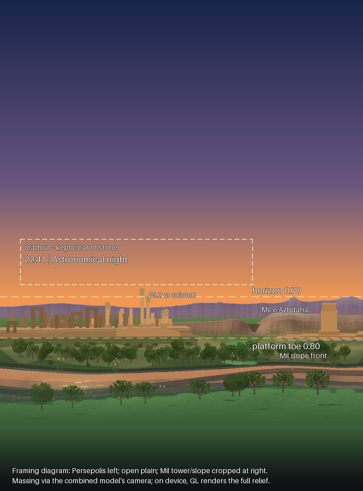

# Persepolis + Mil-e Azhdaha in the Home Landscape

**Scope:** the full-bleed Home sky scene (`HeroSkyCanvas`, `SkyCanvasPresentation.SCENE`), on the two
photographic themes. The ground band's subjects are now two Iranian stone monuments in one supplied
fixed-camera composition: the Apadana east façade at Persepolis in the left distance, and the
Mil-e Azhdaha fire-temple tower at the far right, standing on a stepped limestone hillside that
runs modestly beyond the phone frame. Both are rendered as lit procedural 3D reliefs by the same
real Sun and Moon that light the sky behind them. Persepolis retains the approved half-size,
leftward and farther-back placement from the previous iteration; separate footprint-local
earthworks in the painted ground seat its cut-back platform and the nearer tower slope without
inventing a continuous archaeological patch across the plain between them.

```bash
./gradlew :app:testDebugUnitTest --tests '*PersepolisFramingTest*' --tests '*LandscapeProfileTest*'
python3 tools/persepolis/verify_framing.py
```



*Framing proof, not a screenshot: the Persepolis frames/jambs/columns, the Mil-e Azhdaha tower and
the nine fixed sheets of its slope as flat blocks, projected with the model's fixed lookAt/ortho
camera at the framing ZIG computes, over the scene's ridges, mist and ground at 360 × 420 dp. On
device the GL layer renders the full procedural relief — fluted drums, composite capitals, relief
registers, ashlar tower courses and two procedural limestone shaders. Regenerate with
`tools/persepolis/render_framing_preview.py`.*

---

## 1. What was integrated, and how exactly

The replacement arrived as one self-contained Kotlin file (`PersepolisMilAzhdaha.kt`: OpenGL ES,
no assets, geometry generated procedurally into static VBOs — 148,985 triangles / 165,492 vertices —
with one fixed camera and all "3D behaviour" in the lighting). It now lives at
`app/src/main/java/com/alijafari/red/astronomy/ui/persepolis/PersepolisMilAzhdaha.kt`,
**integrated exactly where the Home scene permits** — same builders, same element tables, same
fixed camera and same Sun/Moon light derivation — with nine changes, each recorded in the file's
header note. Six are host/lifecycle adaptations (including #9, the TextureView host); the last two are the explicitly
requested Home placement and material harmonization:

| # | Change | Why |
|---|---|---|
| 1 | Package line | As the file's own first line instructed |
| 2 | `PersepolisMilAzhdahaScene.init()` drops stale GL names before rebuilding | `init()` runs per fresh EGL context; Home's scene is a `LazyColumn` item, so the surface *will* be destroyed and recreated on scroll. Unpatched, a later `init()` appended second chunk sets for **both** programs and drew buffer names from the dead context |
| 3 | CPU mesh arrays for both monument groups memoised per process | Each `MeshBuilder` is deterministic (fixed LCG seed), and the caches preserve the supplied Persepolis-then-Mil build order and baked transforms, so the arrays are bit-identical; only VBO uploads repeat per context. Scroll-back stays near-instant instead of rebuilding ~149 k triangles on the GL thread. Roughly 8 MB retained |
| 4 | EGL context preserved across pauses (was `setPreserveEGLContextOnPause(true)` on the supplied overlay view) | Backgrounding the app need not re-upload static VBOs where the context survives; since #9 the context belongs to the host's own render thread, which keeps it across pauses structurally; change 2 covers the rest |
| 5 | GL calls via the ES 3.0 API on an ES 3.0 context (was ES 2.0) | The app declares ES 3.0 in its manifest and keeps every renderer on it, guarded by `AnimationRecordPrecisionTest.legacyRenderersStayOnGles3…`. ES 3.0 compiles the supplied GLSL ES 1.00 shaders unchanged; this is an Android API/context change, not a shader rewrite |
| 6 | Optional `centerFractionFromLeft` framing input | Places the unchanged fixed-camera combined group left of centre by shifting only the orthographic window. The default remains 0.5 (the supplied centred framing); ZIG passes 0.30 for the Home landscape |
| 7 | `MIL_HOME_RIGHT_SHIFT_M = 66 m`, applied only to the cached Mil mesh | Moves the complete tower/foot/slope group to the far right without touching any Persepolis transform. On the retained 178 m phone window the tower centre lands at 90.8 % of width and its slope spans 76.3–109.8 %, so the upslope is cropped by the edge rather than terminating inside the field |
| 8 | Persepolis palette unified as **one** warm limestone hue at ten values, matching the Mil family; restrained distance-scaled grain, tooling relief, sparse scalar staining, aerial softening and a final hue-lock blend in `FRAGMENT_SHADER_P` | The supplied Persepolis program was deliberately cooler and comparatively flat, which made the two ruins look as if they came from different material worlds; and its frame stone was a neutral grey, which against warm limestone reads as a *second* stone colour. Every index now shares one hue (frames/recesses differ only in value), all shader variation is scalar, and settled dust is the same stone powdered — so the monument can never split into two colours. The value hierarchy is retained; the Mil program and palette remain exactly as supplied |
| 9 | Overlay view replaced by a TextureView host (`PersepolisTextureView.kt`: TextureView + hand-rolled EGL thread, the way `SkyPanoramaSurfaceView` hosts the panorama) | The supplied overlay surface claimed the top window z-order and composited above the *entire window*: it punched through the search overlay, the fullscreen viewer and every other Compose overlay, ignored the scene's clipping, and could swim behind fast scrolls. As ordinary window content the relief now takes Compose z-order, clipping and scrolling like the painted layers; the splash gate (`LocalSplashActive`) that papered over the same punch-through for the intro is gone with it. Scene, shaders and the render-on-demand cadence are unchanged |

Persepolis' placement is preserved exactly: it is baked at `PERSEPOLIS_X = -9.7 m`, and its empty
platform wings remain cut back. The Mil group retains its supplied 2.04× scale, −0.20 rad yaw and
base translation `(40.7, 1.1, 15.6)`, then receives the Home-only +66 m world-x translation, for a
baked tower centre of `(106.7, 1.1, 15.6)`. The retained Mil geometry is the tower, its local
rubble/sand/scrub foot group and `milSlope()`; the standalone wide bedrock pavement and ledge set
excluded by the combined builder stay excluded.

Hosting was the file's **Option A** (a transparent overlay surface claiming the top window
z-order); it is now a **TextureView** (`PersepolisTextureView.kt`: TextureView + hand-rolled EGL
thread, RGBA8888 + 16-bit depth, render-on-demand — change 9), wrapped by `PersepolisLandscape`
(`ui/persepolis/PersepolisLandscape.kt`) and inserted in `HeroSkyCanvas` between the sky canvas
and the cloud-motion canvas. Option B (drawing the scene inside a host GL renderer) is still not
used: the Home sky is a Compose `Canvas`, not a GL renderer. A TextureView is the hosting this
codebase already trusts for in-window GL (`SkyPanoramaSurfaceView`, `ArSkyGlView`), and it costs
one texture copy per presented frame plus a hand-owned EGL lifecycle in exchange for true
in-window compositing.

**What did not change:** the Compose ground band ([`SceneGroundRenderer`](HOME_SKY_SCENE.md)) is
painted underneath the GL stone — far ridge, mid ridge, ground, grass — because it is
the monuments' environment: the ridges are their distance backdrop, and the field below
their feet is the foreground. The fullscreen viewer (`HOME_HERO`/`LandscapeRenderer`), the Live Sky
backdrop, and the four stylised themes are untouched.

### Theme gate

`PersepolisFeature.isEnabledFor` (mirroring `SkyPanoramaFeature`) enables the layer for **Real Sky**
(the default theme) and **Atmospheric Sky** — the two photographic themes realistically lit
limestone reliefs belong to. Papercraft, Kids Watercolor and Monochrome Scientific are deliberate
flat styles and keep their ground; Observatory exists to emit nothing but red light, and a
full-colour GL layer would defeat it. The grounding paint in the sky pass reads the same gate, so
disabling the feature removes every trace of it.

## 2. The lighting feed

No new astronomy. `SkySceneFrame` already computes, for the exact instant the sky is drawn:

- `sunHoriz` — Sun azimuth/altitude from `CoordinateEngine.equatorialToHorizontal`, azimuth measured
  **from North = 0°, East = 90°** — precisely the convention
  `PersepolisTextureView.setSun` takes (its world axes are +X = north, +Z = east;
  `dirFromAzAlt` needs no conversion);
- `moonData` — Moon azimuth/altitude/illumination from `MoonEngine`.

`PersepolisLandscape` forwards both, with the Moon's intensity scaled by the illuminated fraction
as the file prescribes (`0.22 × fraction`, `persepolisMoonIntensity`). One shared light state feeds
both monument programs. Mil-e Azhdaha keeps its supplied warm close-range stone shader with
noise-gradient bump, tooling, desert varnish, salt, calcite and lichen detail. Persepolis is
deliberately **one stone colour**: every palette entry is the same warm limestone hue at a
different value (bright relief and columns, mid platform, deep-brown frame stone, warm
near-black recesses), every procedural variation in its shader is scalar — value may wander,
hue may not — and a final hue-lock blend pulls each fragment 30 % toward that hue line at its
own luminance. On top of that single material sit only quiet, distance-scaled effects: fine
grain, shallow tooling relief, sparse staining, less specular/rim response and a little more
aerial softening, so it reads as the same stone as the tower, farther away. Colour, intensity,
twilight fade and hemisphere
ambient are still derived inside `PersepolisMilAzhdahaScene.setSun` from altitude, exactly as
supplied — in agreement with the Compose sky's own `LightingState`, because both read the same Sun
altitude.

Updates are `LaunchedEffect`s keyed on the ephemeris values, so the GL view renders **one frame per
sky-model change**: every 15 s bucket at idle (zero cost between), per frame while the finger
scrubs time (the light visibly sweeps across both ruins with the sky), and on location or theme
change. The 24 fps cloud clock never touches it.

## 3. Framing — `PersepolisFraming`

`ui/rendering/PersepolisFraming.kt` (pure pixel arithmetic, `SkySceneLayout` style) turns the scene
size into the view's three inputs (`visibleWidthMeters`, `baseFractionFromTop`,
`centerFractionFromLeft`) and the platform/slope pixel bounds used by the ground painter. Rules, in
priority order:

1. **Exactly half the first Persepolis linear size, retained.** The previous framing's visible
   width — the earlier model's 89 m window on phones, or the aspect-grown width required by its
   34 % building-height cap on wide scenes — is still doubled. The combined file's own 116 m
   default is therefore deliberately not used in Home: it would undo the approved 50 % reduction.
2. **Persepolis left, Mil-e Azhdaha alone at the right.** The combined-frame anchor `(0, 0, -2)`
   still sits at 0.30 of the width, so every Persepolis landmark is unchanged: exact projection
   puts its detailed façade at about 2–50 % of a phone scene and its cut-back platform ends near
   53 %. The shifted tower centre is at 90.8 %, while its slope spans 76.3–109.8 %: the tower and
   downslope remain legible, the upslope exits through the edge, and ordinary plain separates the
   platform from the slope's left feather. On genuinely wider windows, which reveal more world
   rather than merely stretching the same one, the whole slope naturally returns inside the frame:
   it spans 57.7–77.8 % on the tested tablet and 53.1–69.9 % on the wide-short scene.
3. **Farther back in the ground plane.** The Persepolis toe targets 0.098 of the scene below the
   horizon — about 0.798 of the scene — as before. The platform top and slope top stay below the
   horizon, both tall Persepolis columns still cross it, and a deep foreground field remains in
   front of the stone. The Mil slope is nearer the camera: its fixed front step projects about
   0.97 view-metres below the Persepolis toe, so the framing exposes a separate slope-front row
   instead of forcing both monuments onto one contact line.
4. **No stone over the readout.** The GL surface composites *above* its Compose siblings. The toe
   is lowered only as needed until the tallest Persepolis structure entering the protected
   250 dp readout width clears its bottom edge by a nominal 5 dp; every guard x is now in
   combined-scene world coordinates after the −9.7 m bake. The tower needs no separate Kotlin
   guard because it is lower than and to the right of the tallest Persepolis column, but the
   exact-projection verifier checks the tower explicitly. The binding exact clearance across the
   size matrix is **+3.5…+6.2 dp**.

The Persepolis pixel landmarks continue to use the isotropic `widthPx / visibleWidthMeters`
approximation. The Mil tower and slope instead use precomputed fixed-camera **view-space offsets**:
the tower's shifted baked world centre `(106.7, 15.6)` in XZ projects to +108.14 view-metres from
the anchor, and the nine fixed slope sheets project to +82.34…+142.08 view-metres. In world terms
those sheets span x 79.68…141.72 m, y 0…6.06 m and z 0.39…43.24 m; their bottoms land on world
y = 0. Using the
view-space values keeps the painted contact patch registered with the nearer slope to within
0.02 dp in the exact verifier, rather than allowing a multi-metre depth-coupling error.

Measured results (exact lookAt/ortho, `verify_framing.py`):

| Scene | Visible width | Toe at | Sky silhouette, two tall columns | Slope span | Binding readout clearance |
|---|---|---|---|---|---|
| 320 × 380 dp | 178.0 m | 0.798 | 6.3 / 0.2 dp above horizon | 0.763–1.098 | tallest column +5.7 dp |
| 360 × 420 dp | 178.0 m | 0.798 | 7.9 / 0.9 dp | 0.763–1.098 | tallest column +4.1 dp |
| 430 × 480 dp | 178.0 m | 0.804 | 8.5 / 0.3 dp | 0.763–1.098 | tallest column +3.5 dp |
| 360 × 312 dp | 178.0 m | 0.831 | 8.3 / 1.4 dp | 0.763–1.098 | tallest column +3.7 dp |
| 1200 × 560 dp | 297.5 m | 0.798 | 42.9 / 29.1 dp | 0.577–0.778 | great doorway +6.2 dp |
| 800 × 312 dp | 356.0 m | 0.799 | 23.4 / 15.7 dp | 0.531–0.699 | centre stack +3.8 dp |

The framing also guarantees the scene's internal `autoFitHeight` never widens the view past the
chosen width, so the scale the ground painter assumes is the scale the camera uses.

### The Marvdasht landscape and grounding (why it does not look pasted)

On the photographic themes the painted ground is no longer a generic ridge-and-grass band: it is
the monuments' own geography, art-directed to the framing (`SceneGroundRenderer`'s photographic
path, profiles in `LandscapeProfile`). The backdrop is the country the Mil-e Azhdaha tower
actually stands in, west of **Nurabad (Mamasani), Fars**: the tower (دیمه‌میل / میل اژدها)
stands at the foot of the rocky, relatively green limestone ridge of Kuh-e Shirmard /
Tang-e Kalleh in the Dimeh-Mil valley, under the folded Zagros of Mamasani — so the scene
paints, back to front:

- the **far Mamasani fold range** and the **Dimeh-Mil / Mil-e Azhdaha massif** as domain-warped ridged-multifractal
  skylines (Musgrave `(1−|noise|)²` with ridge-weighted detail) given fold-and-thrust geology:
  soft bedrock benching (hard limestone beds terrace, marl washes smooth), a carved water-gap
  notch whose alluvial fan spills out below it, strata dipping away from the fold hinge in a
  chevron, pale hard-limestone caprock on the crests, talus cones at the angle of repose under
  the steepest faces, desert-varnish streaks on the cliffs, and envelopes that keep a low
  shoulder behind the ruins/readout while the whaleback crest swells behind the tower. Each
  range is facet-shaded from its profile slope against the *actual* Sun's screen side, with
  erosion gullies, a crest catch-light, and depth-graded aerial perspective into the scene's
  haze colour — at night the same shapes collapse to a moonlit silhouette. The relief is
  kept honest to the real topography: Nurabad sits at ≈920 m in the Zagros fold-and-thrust
  belt, its ridges rising to roughly 1,500–2,500 m, so the ranges stay low whaleback
  ridges whose crests ride just above the horizon line, *below* the tallest column tops —
  the ruins dominate, the mountains frame. The massif is cut by the wide gorge
  (**Tang-e Farakh**, the Tang-e Kalleh cleft of the site) with a shadowed throat and the
  Dimeh-Mil spring greening its mouth, and both ranges carry the open *Quercus brantii*
  oak-woodland grain and green scrub wash of the real Mamasani hills;
- **piedmont foothills and alluvial fans** where the massif's gullies debouch, then the
  a **lively cool-green plain** (the floor itself re-toned from the old yellowy
  olive-straw to green) with an irrigation canal and its tree line, and a **uniform
  grass field** built on the researched distant-grass solution — the ground-as-grass
  impostor (hexaquo's grass-LOD work) with Ghost-of-Tsushima's field-as-one-mass
  shading: *no individual blades are rendered anywhere*. The field is one textured
  mass: a perspective grid of overlapping tone cells (fbm patch albedo × river/canal
  moisture) quantized into eight cool-green colour buckets — eight path fills for the
  whole valley — with tone contrast compressed at range (the mipmap lesson), and, on
  the viewer's own near bank, the same field deepened into a lush moisture ribbon
  hugging the water. Never in the water, the canal thread, the clearings or on the
  Mil slope front;
- a **broad Pulvar river** the viewer stands across from — no longer a hand-painted ribbon but
  the supplied **`PulvarRiver3D.kt`** reach, ported whole into `PulvarRiver` and rendered by
  `PulvarRiverSprite`. The design is a 224 m pool–riffle–run channel with an asymmetric
  thalweg, gravel point bars inside its bends, a real bed under genuinely transparent water,
  boulder and cobble fields, reeds and bank grass, lit by the design's own Sun/Moon and
  shaded by its own `shadeOpaque`/`shadeWater` — Schlick Fresnel, Beer–Lambert absorption
  with turbidity, caustics on the submerged bed, and a hydraulic foam mask that carries the
  riffle crests and each boulder's bow wave and wake. This scene replaces only the design's
  *projection*: `PulvarRiver.Frame` maps the reach onto the band the valley's planting was
  always built around, so the meander, the riffle rhythm and the channel's width variation
  all survive while the trees, the field, the canal and the aprons keep their clearance. The
  corridor's outer edge fades into the plain and the whole bake is multiplied by this frame's
  light — the same per-channel tint the maples and Paulownias get — so the water is lit by the
  scene's Sun, dims with its ambient and takes the Moon's glitter column at night instead of
  its own. Resolution is the one thing the design's shading cannot survive unchanged: its
  ripple field is authored for a close 3D camera, so the field is stretched (0.14) and its
  normals damped to what a 3.1 px/m band can actually resolve. One bake per layout and
  season, then one blit per frame plus the glitter. See the four-state render
  [`pulvar-river.png`](pulvar-river.png) and `PulvarRiverTest`;
- a **parkland of exactly two species** — the supplied **Paulownia** and **sugar maple** designs,
  and *neither* is grown per tree. Each is the supplied design's single tree, grown once and
  **rendered once** into a small sprite per season, then *projected* at every planting: mirrored
  where the scene wants variety, faded for the far bank and multiplied by the frame's own light.
  The oak (*Quercus brantii*), the wild pistachio and the *Artemisia* scrub that used to grow here
  with 2D space colonization, self-organizing-model pruning and da Vinci pipe radii are gone —
  every one of their slots (riparian gallery, canal line, foothill woodland, scattered plain,
  groves, near-bank frames, and the lone tree between the two sites) is a sugar maple now, plus
  seven more across the plain;
- **the space between Persepolis and Mil-e Azhdaha**, planted with both species in three receding
  bands of four: the farther back a band sits, the smaller its trees
  (`H·0.030`, `H·0.041`, `H·0.056` at `toeY + H·0.030/0.060/0.090`), with aerial perspective
  thinning toward the front. Because both species are projections, that perspective step costs a
  smaller blit and nothing else;
- the **sugar maple** (*Acer saccharum*): the supplied `SugarMaple.kt` design — 19.6 m to the crown
  top, 0.94 m trunk at breast height with a broad root flare, ten hand-placed scaffolds staggered
  3.35–7.40 m up the leader, a 15 m oval crown `(0, 11.05, 0)` / `(7.55, 7.35, 4.55)`, opposite
  leaf pairs, interior clusters, paired winged samaras and buds. Its 807k-vertex summer mesh is why
  it is a sprite and not a mesh here. About fifty plantings cost fifty image blits and two bitmaps.
  See [`SUGAR_MAPLE_TREE.md`](SUGAR_MAPLE_TREE.md);
- the **Paulownia** (*Paulownia tomentosa*): the earlier supplied design, 13.8 m, a 0.62 m trunk, a
  13.4 m crown, lilac terminal panicles on bare wood in spring. See
  [`PAULOWNIA_TREE.md`](PAULOWNIA_TREE.md).

**Both species are dated by the Persian calendar** (`PersianCalendar`): the valley is drawn for one
instant, and its foliage is that instant's Persian season — spring from **1 Farvardin** (Nowruz,
20/21 March), summer from 1 Tir, autumn from 1 Mehr, winter from 1 Dey. The maple is green in
spring and summer and red-orange in autumn and winter; the Paulownia keeps its four wardrobes.
Scrub grows only in the foothills (now as maple saplings) — the river's near side is kept clean so
the scene's bottom can dissolve into the app backdrop (see `HOME_SKY_SCENE.md`).

Everything else in the vegetation is *static geometry cached per layout*
(`VegetationGeometry` in `SceneGroundRenderer`): the grass field is baked into eight tone-bucketed
`Path`s once per canvas size/framing/Sun-side, and each draw replays eight fills with live lighting
colours. The trees are not geometry at all: two baked bitmaps and ~90 blits. Rebuilding ~13k
individual tree draw calls on every 1 Hz tick — and on every frame while scrubbing — is what
previously made the sky canvas and Home scrolling hitch.

The composition was tuned visually in `tools/persepolis/render_framing_preview.py`, which mirrors
the same profile algorithms over the exact framing (the diagram at the top of this file). The
stylised themes keep the older flat ground band untouched.

Within that landscape, a transparent overlay would still end on a hard line unless the host paints
the contact. `SkySceneRenderer` passes the full framing to
`SceneGroundRenderer.drawCombinedLandscapeGrounding`, which paints **two separate worn
clearings** in the middle of the stack (after the plain, before the river):

- an **irregular Persepolis apron** around the cut-back platform, with wavy edges and both vertical
  and horizontal feathering, strongest at the toe and dissolving into the ordinary field;
- a lower-alpha **Mil slope apron** based on the exact slope footprint, extending past the right
  edge on phones so no artificial terminal rim appears where the 3D hillside is cropped;
- **talus and limestone dust** beneath the slope's visible downslope/front contact, where weathered
  material would actually collect — not a decorative bank past an off-screen upslope;
- a platform-only **broken contact shadow**, plus a deeper soft crescent at the slope's nearer
  front step;
- low, soft **drift hummocks** and deterministic light/dark **debris flecks** seeded separately in
  each clearing, so no line of procedural debris bridges the untouched field between the sites.

The soft drifts are built from many equal-alpha shells whose source-over accumulation reaches the
intended peak gradually; earlier few-step ellipses produced visible concentric contour rings and
were removed. Colours are mixed from the active ground palette toward sand and scaled by
`LightingState.ambientBrightness`, so the patch follows the terrain's warmth and brightness and
vanishes into astronomical night with it. Exact projection puts the forecourt front edge 0.6–1.3 dp
above the toe row and the slope front inside the contact-shadow band on every tested size. The
river, scrub and tuft grass then paint over the foreground tails of the clearings, tying
both sites back into the living plain.

## 4. Lifecycle, cost, interaction

- `PersepolisLandscape` forwards `ON_RESUME`/`ON_PAUSE` to the TextureView host from the
  composition's lifecycle owner (pausing gates GL drawing; the context and VBOs survive) and frees
  both program/chunk sets on the render thread in `onRelease`. First surface
  creation runs the two procedural builds on the GL thread while the sky and ground are already
  visible through the transparent texture; every later creation re-uploads from memoised arrays.
- The view is non-clickable/non-focusable and consumes no touches: tap-to-identify and finger time
  travel on the canvas are unaffected (its geometry is not hit-tested — a tap on a star projected
  over a column still identifies the star).
- Per-repaint cost is the file's own: two shader programs drawing their static ≤60 k-vertex VBO
  chunks, on demand. At idle that is one frame per 15 s model bucket; the surface does no work
  between light changes.
- **Splash gate (removed with change 9).** The one-shot splash is only a Compose overlay over
  the already-composed Home scene, and the old window-level surface used to show straight
  through it; `MainActivity` provided `LocalSplashActive` and `HeroSkyCanvas` held the relief
  uncomposed until the splash completed. With the relief on a TextureView it is ordinary scene
  content that the splash covers like everything else, so the gate and the plumbing are gone.

### Known trade-offs (honest list)

- **In-window compositing (the TextureView bargain).** The relief is ordinary window content:
  Compose siblings drawn after it — the motion veils, selection ring, readout, and overlays such
  as the sky search (scrim included) — cover and dim it exactly like the painted layers, it
  follows the canvas's clipping, and it scrolls with the feed instead of trailing a
  window-level surface. What remains physically ordered is what the painter's order decides:
  cloud veils drift behind the ruins, and a near-horizon selection ring now draws *over* the
  stone that occludes its object (a usability win the old surface made impossible). The costs
  are one texture copy per presented frame and a hand-owned EGL thread, both of which the app
  already pays for the panorama and the AR sky. Framing (§3.4) still keeps stone off the readout
  and header — as composition, not survival.
- **Fixed combined view.** One fixed camera and the supplied composite placement. Persepolis and
  the Nurabad-area Mil-e Azhdaha are real places, but this is not a literal single viewpoint from
  which both are visible together, and it is not tied to the observer's location. It is the Home
  scene's archaeological landscape composition, crossed by the Sun and Moon of the observer's own
  sky; it must not be described as the view from the user's location or as the monuments'
  geographic relationship.
- **No cast shadows.** Depth occlusion is real and both shaders model direct/ambient response;
  monument-on-ground or column-on-platform shadow maps would need an additional pass around the
  supplied draw calls if they are ever wanted.

## 5. Verification

- `PersepolisHostingGuardTest` (JVM, source-shape): the relief stays hosted on a TextureView
  with its own EGL thread, and no window-top GL surface claim returns to the persepolis package.
- `PersepolisFramingTest` (JVM): the retained half scale, left placement, distant toe,
  protected-readout rules, cut-back platform and Mil slope/tower footprint ordering over six scene
  sizes, the theme gate, and the moonlight scaling.
- `tools/persepolis/verify_framing.py` (stdlib): replicates `Matrix.setLookAtM`/`orthoM` and
  `PersepolisMilAzhdahaScene.draw`'s centre-solving (including the 0.30 horizontal offset),
  projects the toe, anchor, forecourt edge, platform top/corners, tall columns, doorway, façade
  ends, tower top and all corners of the slope's nine fixed sheets through the framing. It
  transforms those slope corners with the file's baked Mil scale/yaw/translation rather than
  trusting the Kotlin constants, and checks every tall landmark — the tower included — that enters
  the readout's protected width. Measured Persepolis approximation error across the matrix is
  ≤ 2.6 dp for the column, ≤ 1.3 dp for the doorway, ≤ 0.7 dp for the platform top and ≤ 6.1 dp
  for the platform's right edge; tower/slope landmark error is ≤ 0.02 dp.
- `tools/persepolis/render_framing_preview.py` (Pillow): regenerates the diagram above.
- The GL code itself needs a device or emulator: `assembleDebug`, open Home on Real Sky, scrub
  time across sunrise/noon/sunset/night, scroll the feed away and back (surface recreation via
  changes 2/3), background and resume the app, switch to Papercraft and back (gate).

## 6. Tuning

- On/off and themes: `PersepolisFeature` (`ui/persepolis/PersepolisLandscape.kt`).
- Linear scale, horizontal centre, distant-toe position, slope footprint and readout clearance:
  `PersepolisFraming` constants (`LINEAR_SCALE_FRACTION`, `CENTER_FRACTION_FROM_LEFT`,
  `DISTANT_TOE_BELOW_HORIZON_FRACTION`, `MIL_SLOPE_*`, `READOUT_CLEARANCE_DP`).
- Worn-earth, slope bank/dust, shadows, hummock and debris strength/reach:
  `SceneGroundRenderer.drawCombinedLandscapeGrounding`.
- Monument transforms and light character: inside `PersepolisMilAzhdaha.kt` — changing these
  changes the supplied model, so prefer the host-side knobs above.
