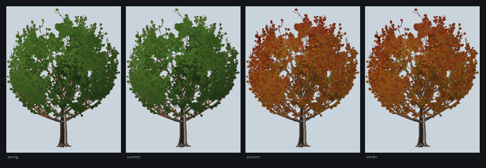

# Sugar maple — the supplied design, one render projected everywhere

The valley's second tree is the sugar maple (*Acer saccharum*) from the supplied
`SugarMaple.kt` design. It replaced the Zagros oak, the wild pistachio and the Artemisia sage
completely: **the Marvdasht landscape now holds exactly two species, Paulownia and sugar maple**, and
both are one render projected at every planting.

*One tree, four wardrobes — spring, summer, autumn, winter, left to right. Spring and summer are the
green crown; autumn and winter are the red-orange one, as specified.*

## Why it is a sprite and not a mesh

The design is a GL ES 2.0 scene: an orthographic camera at `(0, 12.4, 58)` looking at
`(0, 8.7, 0)`, 1 unit = 1 m, and two baked meshes —

| Mesh | Vertices | Triangles |
|---|---|---|
| summer (`MAPLE_SUMMER`) | 807,287 | 680,730 |
| autumn (`MAPLE_AUTUMN`) | 788,532 | 666,624 |

Sixteen trees at ~40k triangles each would be ~640k triangles of tree before a single mountain facet,
and the design's own chunking (≤60k vertices per buffer, for 16-bit indices) exists precisely because
one tree already fills several buffers. The valley cannot pay that per instance, per frame.

So the tree is **grown once, rasterised once per look and per display size, and blitted**. Roughly
fifty plantings cost roughly fifty image quads and two bitmaps. That is the user's own instruction:
*"render only one and project the render everywhere else"*.

## What is kept from the design

Everything that makes it this tree, rather than a generic broadleaf:

- **Frame** — crown `(0, 11.05, 0)`, radii `(7.55, 7.35, 4.55)` m; ≈19.6 m tall; 0.94 m trunk at
  breast height with a broad root flare (six flare roots).
- **Ten hand-placed scaffolds** staggered 3.35–7.40 m up the leader, with the design's own
  directions, lengths, energies and radii.
- **Growth rules** — the same 32-bit LCG (`s = s·1664525 + 1013904223`, output
  `(s >>> 8 & 0xFFFFFF) / 2²⁴`), the same seeds (`0x5ACE2026`, `0x2545F491`), the same step-length
  rate, taper ladder, opposite forking probability, energy split, jitter and curve amount, the
  same `cd > 0.94` crown-shell clamp (bend back along the ellipsoid gradient, weaker if the point is
  outside the shell entirely), the same 2.75 m growth floor, the same current-year shoot passes
  (tips, high nodes, 2nd/3rd order wood, scaffold wood) and the same **850-twig crown-gap fill** with
  its nearest-node search and its forked tip.
- **Canopy** — opposite pairs on the last orders, terminal bunches, interior clusters, samaras
  (paired winged seed bodies) and buds, all on the sites the design puts them, with its own hue
  coordinate (0 = lingering green → 1 = scarlet) shared by both looks, so spring and autumn agree
  about which part of the crown is which.
- **Palette** — the design's 24-entry palette, translated to finished daylight sRGB.

## What changed, and why

| Design | App | Reason |
|---|---|---|
| 2,300 axes, ~15,400 leaves, ~6,300 clusters | same axes, ~1,600 leaves, ~1,100 clusters | a landscape tree is 20–95 px tall; a 12 cm blade is sub-pixel. A **deterministic stride** keeps every 6th leaf / 4th cluster uniformly over the crown (never a truncated prefix, which would bald one side), and the blades are drawn 2.2× larger so the silhouette still frays. |
| Two 800k-vertex meshes | one bitmap per look and size | the performance rule above. |
| Vertex AO + ACES grade | a baking sun (high, slightly left, toward the viewer) | the sprite is a finished render; the scene then multiplies the frame's own light over it. |
| `enum SugarMapleSeason { SUMMER, AUTUMN }` | `SugarMapleLook { GREEN, AUTUMN }` | **the user's colour rule** (below): four Persian seasons, two looks. |

## Seasons: the Persian calendar

`PersianCalendar` is the single source of the valley's date. Spring begins on **1 Farvardin**
(Nowruz, 20/21 March), not on 1 March — the arithmetic Jalali calendar (`jalaali-js` /
Borkowski break table), exact for the years the app can show, pure and testable.

| Persian season | Months | Approx. Gregorian | Sugar maple | Paulownia |
|---|---|---|---|---|
| spring | Farvardin–Khordad | 21 Mar – 21 Jun | **green** crown | pale-lilac panicles on bare wood |
| summer | Tir–Shahrivar | 22 Jun – 22 Sep | **green** crown | full green crown, capsules |
| autumn | Mehr–Azar | 23 Sep – 21 Dec | **red-orange** crown | sparse brown leaves, ripe capsules |
| winter | Dey–Esfand | 22 Dec – 20 Mar | **red-orange** crown | bare wood, split capsules, buds |

The maple's mapping is the user's instruction exactly: *summer and spring must be green, fall and
winter the red-orange version*. Inside the red-orange look the design's own progression is kept —
yellow at the crown's shaded heart through gold and orange to scarlet on its lit shell.

A null instant (no date supplied) falls back to summer, never to a guessed month.

## Where the maples stand

Every species slot the oak, pistachio and sage scrub held is a maple now, plus seven more across the
plain, plus both species in the space between the monuments:

- the foreground frame — a maple on the left bank, a Paulownia on the right;
- foothill saplings (7), the open woodland (6), the canal line (5) and the far-bank gallery (6);
- scattered plain maples (4), drained oak groves (8), near-bank additions (**1**, see below) and the
  seven new plantings in the plain between the river and the toe;
- **between Persepolis and Mil-e Azhdaha**: three receding bands of four, both species alternating,
  at `toeY + H·(0.030, 0.060, 0.090)` with heights `H·(0.030, 0.041, 0.056)` — the farther back a
  band sits, the smaller every tree in it, and aerials rising toward the front, exactly the
  perspective the rest of the valley follows;
- **the far-bank back grove**: 20 sugar maples in two staggered rows behind every other far-bank
  tree, at `toeY + H·(0.026, 0.036)`, heights `H·(0.020…0.026)` in the back row and
  `H·(0.030…0.040)` in the row nearer the river (the gallery's own band — this row used to be
  scrub-small), aerials 0.92 / 0.84, alternating with 20 Paulownias across the whole width so the
  band frames both monuments. Six **big** Paulownias stand deeper still. See `LandscapeBackGrove`
  and [`PAULOWNIA_TREE.md`](PAULOWNIA_TREE.md) §4.
- **every tree in the valley is drawn 10 % bigger than its base height**
  (`SceneGroundRenderer.TREE_HEIGHT_SCALE`), applied once inside the two planters so a planting's
  height, its cast shadow and the sprite bake's tallest-tree sizing cannot disagree.

Counts are what stands after refusals: a planting is declined only in the worn earth at the
monuments' feet and in open water, and every grove planting retries one step away from the water
before giving up. The back grove is the one band exempt from the apron rule (its trunks stand in the
distant painted plain, not on stone) — it takes only the river rule, so all forty slots stand at
every aspect ratio.

### The near bank, right to left

The row is hand-placed, and it has been re-arranged twice:

1. 0.955 **Paulownia** — the far right of the screen (it used to be second from the right, at 0.78);
2. 0.875 Paulownia (the right foreground frame);
3. 0.70 Paulownia;
4. 0.66 sugar maple;
5. 0.63 sugar maple;
6. 0.55 Paulownia;
7. 0.40 Paulownia;
8. 0.34 Paulownia;
9. 0.312 **Paulownia** (it used to be second from the left, at 0.20);
10. 0.285 **sugar maple** (it used to frame the left edge at 0.115 — it was moved right, first
    beside the Paulownia at 0.20, then the pair of them right again, so 0.285 / 0.312 / 0.34 now
    stand as one cluster).

The sugar maple the row also used to hold at 0.47 is not planted: that was the seventh tree from
the right, and the foreground is specified without it. The 0.66 maple keeps its own hash index, so
no surviving tree moved for its absence, and the two re-aimed Paulownias keep theirs, so they keep
the heights they had.

## Files

| File | Contents |
|---|---|
| `ui/rendering/SugarMapleTree.kt` | the design's growth, the canopy sites, `SugarMapleLook`, and the Persian-season mapping |
| `ui/rendering/SugarMapleSprite.kt` | the one render: bake, cache, `forLayout`, `draw` |
| `ui/rendering/PersianCalendar.kt` | Jalali conversion and seasons |
| `tools/sugarmaple/preview_sugarmaple.py` | Python mirror of the bake, writes `docs/sugar-maple.png` |
| `app/src/test/.../SugarMapleTreeTest.kt` | determinism, proportions, canopy, season mapping |
| `app/src/test/.../PersianCalendarTest.kt` | Nowruz and the quarter-day boundaries |
